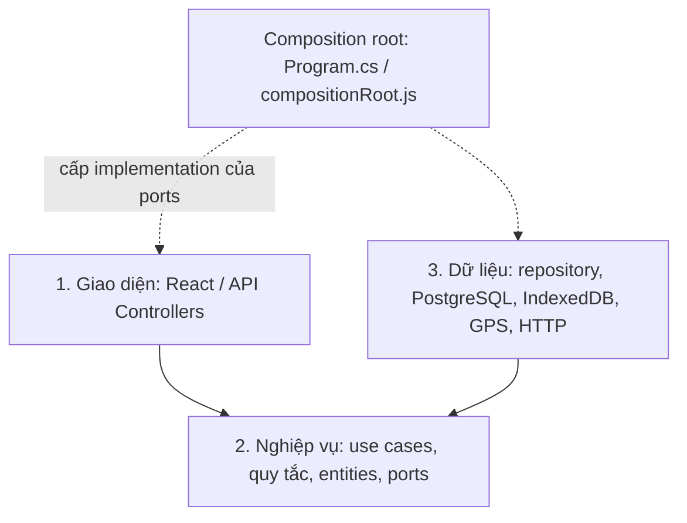

# MapAI — Clean Architecture 3 lớp

Nhánh `work-unified` tích hợp online, offline và Capacitor trong cùng mã nguồn. Website và Android/iOS dùng chung React; backend .NET cung cấp chức năng online. Ba lớp là **Giao diện**, **Nghiệp vụ**, **Dữ liệu / tích hợp thiết bị**.



Luồng thực thi đi từ giao diện tới nghiệp vụ, rồi tới adapter dữ liệu qua interface/port. Chiều phụ thuộc mã nguồn hướng vào nghiệp vụ: nghiệp vụ không import giao diện, Entity Framework, IndexedDB, Capacitor hay framework HTTP. Composition root được phép biết các lớp để kết nối chúng bằng dependency injection.

## Backend

| Lớp | Vị trí trong `MapAI_BE-main/src` | Trách nhiệm |
| --- | --- | --- |
| 1. Giao diện | `MapAI.API/Controllers`, `Middleware` | HTTP, xác thực/phân quyền endpoint, ánh xạ lỗi thành phản hồi. Controller gọi service. |
| 2. Nghiệp vụ | `MapAI.Application`, `MapAI.Domain` | Service/use case, kiểm tra dữ liệu, quy tắc duyệt địa điểm và đánh giá, entity/DTO, interface repository trong `Domain/Ports`. |
| 3. Dữ liệu | `MapAI.Infrastructure` | Repository EF/PostgreSQL, email, JWT, Google identity, AI và dịch vụ bản đồ ngoài. `Persistence/MapAIContext.cs` và migrations nằm ở đây. |

`Application` và `Domain` chia nhỏ cùng lớp nghiệp vụ để giữ entity/contract độc lập; `Common` là thư viện tiện ích hỗ trợ. Số project `.csproj` không phải số lớp kiến trúc. `Application` chỉ tham chiếu `Domain` và `Common`; không tham chiếu `Infrastructure`. `Domain` không chứa DbContext, migration hoặc dependency Entity Framework. `Program.cs` của API là composition root đăng ký DI.

Ví dụ: `CommunityLocationController` → `ICommunityLocationService` → `ICommunityLocationRepository` → `CommunityLocationRepository` → PostgreSQL. Service quyết định quy tắc; repository thực hiện truy vấn và cập nhật dữ liệu, kể cả kiểm soát cập nhật đồng thời. `LocationService` lấy thống kê qua cùng port, không truy vấn DbContext trực tiếp. Google token được xác minh qua `IGoogleIdentityRepository`.

Migrations đã được chuyển sang Infrastructure và giữ nguyên ID migration. Không tạo lại database để chuyển kiến trúc. Chạy từ thư mục gốc repo:

```bash
dotnet tool restore --tool-manifest MapAI_BE-main/.config/dotnet-tools.json
dotnet ef database update --project MapAI_BE-main/src/MapAI.Infrastructure --startup-project MapAI_BE-main/src/MapAI.API
# Khi tạo migration sau này:
dotnet ef migrations add TenMigration --project MapAI_BE-main/src/MapAI.Infrastructure --startup-project MapAI_BE-main/src/MapAI.API --output-dir Persistence/Migrations
```

## Frontend và offline

| Lớp | Vị trí trong `MapAI_FE-feature-map-api/src` | Trách nhiệm |
| --- | --- | --- |
| 1. Giao diện | `pages`, `components`, `features/offline`, `offline/presentation`, `context`, `hooks` | React, trạng thái màn hình, sheet/dialog, tương tác bản đồ. |
| 2. Nghiệp vụ | `map/application`, `offline/application`, các hàm thuần về lệnh/toạ độ trong `utils` và `services/mapTools.js` | Cài/kiểm tra gói, tìm kiếm, trợ lý cục bộ, tính tuyến A*, chuẩn hoá lệnh bản đồ. |
| 3. Dữ liệu / thiết bị | `map/infrastructure`, `offline/infrastructure`, adapter API và vị trí trong `services` | IndexedDB/Dexie, tải asset, checksum, worker, Service Worker, mạng Capacitor, GPS, HTTP tới backend. |

`offline/compositionRoot.js` truyền các port `repository`, `source`, `checksum`, `connectivity`, `storage`, `router`, `location` cho `createOfflineService`. Các facade `offline/packageManager.js`, `network.js`, `pwa.js` giữ API ổn định cho giao diện. UI offline không mở IndexedDB, tạo worker hay gọi GPS trực tiếp. Worker chỉ là adapter chạy thuật toán nghiệp vụ ngoài luồng UI.

`/map` là một workspace công khai, dùng chung `MapPage`, `MapLibreView`, `SearchBar`, `DirectionsPanel` và `PlaceDetailPanel`. `map/application/createMapService.js` chọn adapter online/offline theo trạng thái kết nối. `map/presentation/useMapSession.js` là composition hook cấp service ổn định và cập nhật nguồn dữ liệu; khi đổi mạng không tạo lại MapLibre canvas. `/offline` và `/map/online` chỉ là alias chuyển về `/map`, giữ query/hash. Tài khoản vẫn cần cho chức năng ghi dữ liệu và quản trị. Việc chuyển mạng không xoá token đăng nhập. Đăng nhập, quản trị, đóng góp và đồng bộ server vẫn cần backend.

Capacitor đóng gói shell và gói Đà Nẵng trong APK/IPA, phục vụ asset từ thiết bị. Native không phụ thuộc Service Worker, có thể cài dữ liệu vào IndexedDB ngay lần mở đầu ở chế độ máy bay. Web PWA cần mở online một lần để cache. Dữ liệu cá nhân offline nằm riêng trên thiết bị, chưa đồng bộ lên tài khoản.

## Kiểm tra ranh giới

Trong thư mục frontend:

```bash
npm run test:architecture
npm test
npm run lint
npm run build
npm run test:e2e
npm run test:e2e:offline
```

`tests/architecture.test.mjs` chặn dependency ngược trong lõi offline/backend và truy cập database trực tiếp từ UI offline hoặc controller. Unit test nghiệp vụ dùng port giả thay cho database/thiết bị; integration test backend kiểm tra repository qua PostgreSQL thật. Khi thêm tính năng vẫn phải tuân thủ các ranh giới trên.

## OpenFreeMap chung cho hai chế độ

`map/infrastructure/openFreeMapRuntime.js` dùng một snapshot style Liberty. Online giữ URL OpenFreeMap; offline đổi vị trí tài nguyên sang PMTiles và asset nhúng/PWA, giữ nguyên layer definition. `scripts/build-openfreemap-package.mjs` tải tile thật theo bounds Đà Nẵng, sprite và các glyph được dùng ở vùng này; giữ POI/graph tính đường cục bộ. Manifest gắn `mapProvider: openfreemap`, checksum và nguồn tile; gói định dạng cũ được nhận diện để cài lại, dữ liệu cá nhân vẫn giữ.

Business map trả cùng contract place/route cho UI. `localRoute` chuyển A* sang cấu trúc geometry/distance/duration/steps mà DirectionsPanel đang dùng. UI hủy/bỏ kết quả tìm kiếm hoặc chi tiết cũ khi nguồn thay đổi. Việc đổi style và thêm lại lớp địa điểm/tuyến được đồng bộ theo `style.load`; trạng thái bản đồ sẵn sàng chỉ sau khi nguồn OpenMapTiles tải xong.
